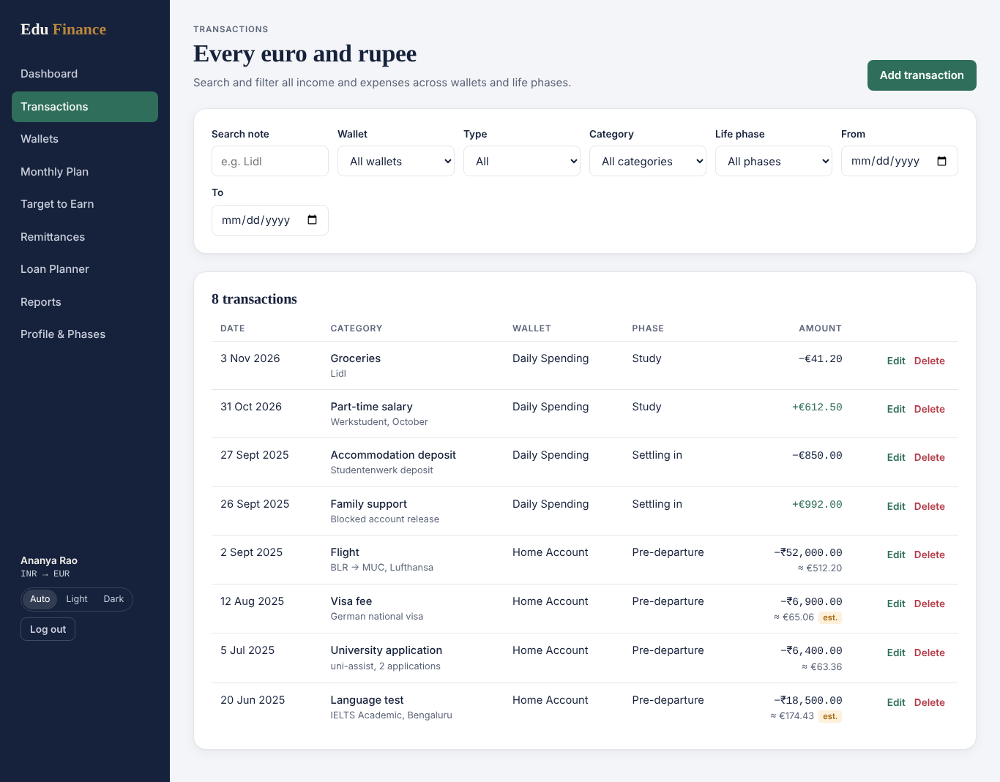
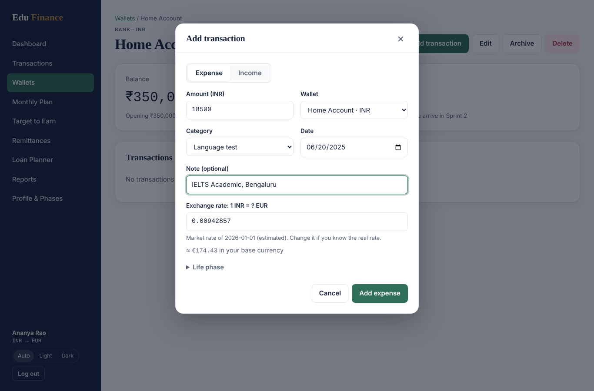

# EduFinance

**From study-abroad student to confident lifelong money planner.**

EduFinance is a web application for international students who manage money in two currencies:
a *home currency* (education loan, family support) and a *base currency* abroad (rent, groceries,
part-time salary). It covers the whole journey – from the first language test and university
application, through settling in and studying, to job search, work and the last loan EMI.

> University project – IU International University, course DLMCSPSE01 *Project: Software
> Engineering*, Task 1 (web application). Author: Suprit Somashekaraiah.

## Features

| Area | What it does | Status |
|---|---|---|
| Accounts | Register with currencies and journey dates, login/logout, profile, password | ✅ v0.1.0 |
| Life phases | Pre-departure, settling in, study, job search, work – every transaction belongs to one | ✅ v0.1.0 |
| Wallets & transactions | Any currency; exchange rate frozen on every entry; filters and search | ✅ v0.1.0 |
| Remittances | Enter amount sent and received → real rate and hidden cost | Sprint 2 |
| Monthly plan & Target to Earn | Fixed costs incl. loan EMIs → minimum monthly earning target | Sprint 2 |
| Loan planner | EMIs, part-payments, interest saved, payoff, part-payment affordability | Sprint 2 |
| Runway | Days of money left per wallet with status and alerts | Sprint 2 |
| Reports & dashboard | Month / year / phase / lifetime; cost of going abroad; net worth | Sprint 3 |

## Screenshots

| Transactions | Add an expense in INR |
|---|---|
|  |  |

More in [docs/screenshots](docs/screenshots/).

## Quick start (Docker)

Requirements: [Docker Desktop](https://www.docker.com/products/docker-desktop/) (includes Docker Compose).

```bash
git clone https://github.com/<your-user>/edufinance.git
cd edufinance
cp .env.example .env        # optional: change secrets
docker compose up --build
```

Open **http://localhost:8080**. Health check: http://localhost:8080/api/health

The backend applies database migrations and seeds master data automatically on every start.

Create your own account on the start page ("Create an account"). A demo login
(`demo@edufinance.app` / `Demo#2026`) with realistic data follows in Sprint 3.

Stop: `Ctrl+C`, then `docker compose down` (add `-v` to delete the database volume).

## Local development (without Docker)

Requirements: Python 3.12, Node.js 22, PostgreSQL 16.

```bash
# 1. Database
createuser -P edufinance                # password: edufinance
createdb -O edufinance edufinance
createdb -O edufinance edufinance_test

# 2. Backend  (http://localhost:5000)
cd backend
python -m venv .venv && source .venv/bin/activate   # Windows: .venv\Scripts\activate
pip install -r requirements-dev.txt
export FLASK_APP=wsgi.py                            # Windows: set FLASK_APP=wsgi.py
flask db upgrade && flask seed-master
flask run --debug

# 3. Frontend (http://localhost:5173, proxies /api to :5000)
cd ../frontend
npm install
npm run dev
```

## Tests and quality checks

```bash
# Backend: tests + coverage, lint, format check
cd backend
pytest
ruff check . && ruff format --check .

# Frontend: tests, lint, production build
cd frontend
npm test
npm run lint
npm run build
```

The same checks run on every push in GitHub Actions (`.github/workflows/ci.yml`).
Test cases with inputs and expected results: [docs/02-Requirements/test-cases.md](docs/02-Requirements/test-cases.md).

## Project structure

```
edufinance/
├── backend/                 Flask API
│   ├── app/
│   │   ├── api/             HTTP layer (blueprints)
│   │   ├── services/        business logic (unit-tested)
│   │   ├── models/          SQLAlchemy models
│   │   ├── seed/            master data and demo data
│   │   ├── config.py        settings from environment variables
│   │   └── errors.py        JSON error format
│   ├── migrations/          Alembic migrations
│   └── tests/               pytest
├── frontend/                React 19 + Vite SPA
│   └── src/
│       ├── api/             Axios client
│       ├── components/      shared UI
│       ├── pages/           one file per screen
│       ├── lib/             helpers (formatting, theme)
│       └── styles/          design tokens and CSS
├── docs/                    project documentation (see docs/README.md)
├── docker-compose.yml
└── .github/workflows/ci.yml
```

## Documentation

* [Project plan (Scrum, backlog, sprints)](docs/01-Project-management/project-plan.md)
* [Requirements](docs/02-Requirements/requirements.md) · [Glossary](docs/02-Requirements/glossary.md)
* [Architecture](docs/03-Architecture-documentation/architecture.md) · [REST API](docs/03-Architecture-documentation/api.md) · [Decisions (ADRs)](docs/03-Architecture-documentation/adr/README.md) · [Tech stack](docs/03-Architecture-documentation/tech-stack.md)
* [Technical debt](docs/technical-debt.md) · [Changelog](CHANGELOG.md)

## Third-party software

All libraries are listed with versions, links and reasons in
[tech-stack.md](docs/03-Architecture-documentation/tech-stack.md). Exchange rates by
[ExchangeRate-API](https://www.exchangerate-api.com).

## Licence

Code: MIT (see `LICENSE`). Created as an examination performance at IU International University.
