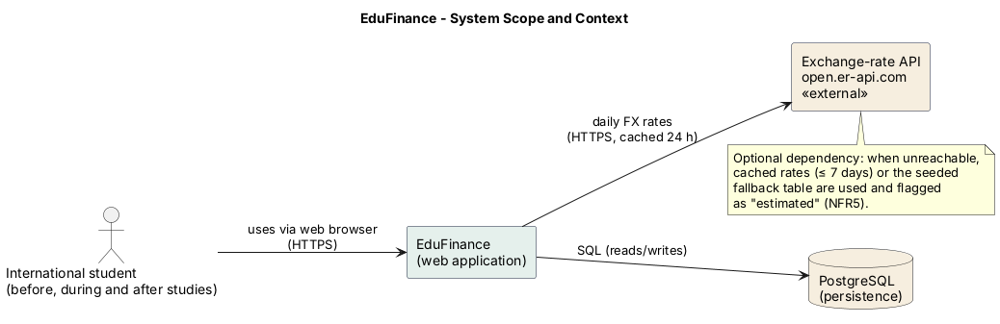
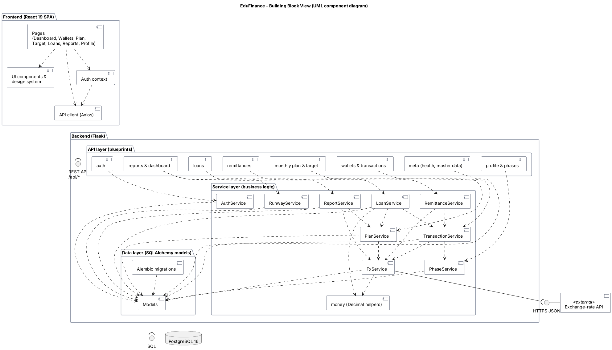
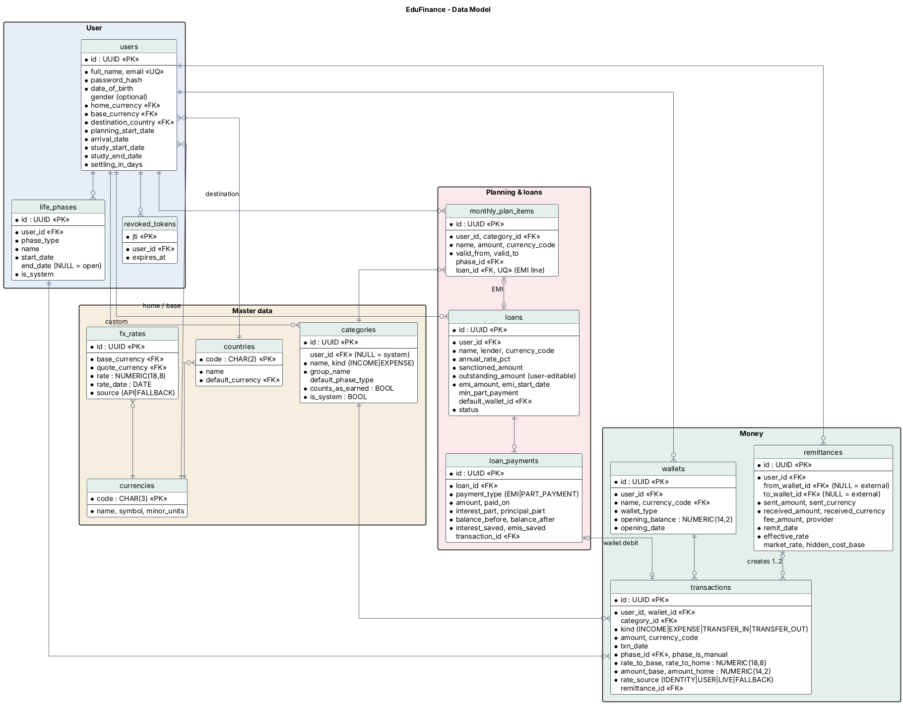
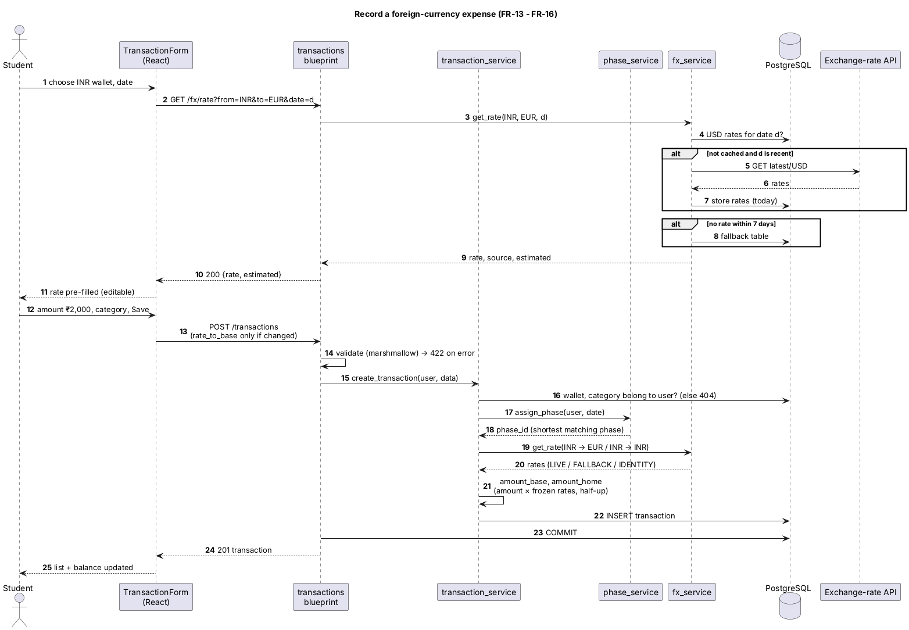
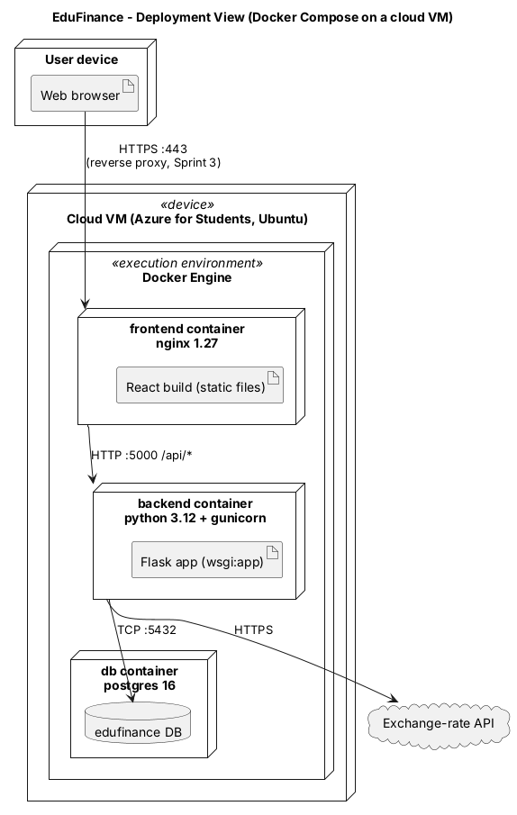

# Architecture Documentation – EduFinance

Structure follows [arc42](https://arc42.org/) (sections relevant for this project).
Diagrams are written in PlantUML (`diagrams/*.puml`, PNG exports in `diagrams/png/`).

## 1. Introduction and goals

EduFinance helps international students plan and track money across two currencies and across
their whole journey: before departure, settling in, studying, job search and work. See the
[requirements](../02-Requirements/requirements.md).

**Top quality goals**

| Priority | Goal | Scenario |
|---|---|---|
| 1 | Correctness | A €0.01 difference never appears through rounding; past values never change (NFR-09, FR-15). |
| 2 | Security & privacy | A user can never see another user's data (NFR-07). |
| 3 | Usability | A first-time user records an expense within 60 s (NFR-03). |
| 4 | Installability | `docker compose up --build` starts everything (NFR-10). |

## 2. Constraints

* Single developer, about 140 hours, three one-week sprints (Scrum).
* Must run in a web browser, be hosted in the cloud, ship as docker-compose, code public on GitHub.
* Only free services may be used.

## 3. System scope and context

| Neighbour | Interface | Purpose |
|---|---|---|
| Student | Browser, HTTPS | All use cases |
| PostgreSQL | SQL over TCP | Persistence |
| Exchange-rate API | HTTPS JSON, daily | Market rates (optional; cache and fallback – ADR-0003) |

## 4. Solution strategy

| Goal | Approach |
|---|---|
| Correctness | Decimal arithmetic end-to-end (ADR-0002); rate freezing (ADR-0003); business rules as DB constraints |
| Maintainability | Layered backend: thin routes → services (all business logic) → models; one service module per domain |
| Testability | Services are plain functions on models; tests run against a real PostgreSQL via the migrations |
| Security | JWT with expiry and revocation (ADR-0009); per-user filtering in every query; UUID keys (ADR-0004) |
| Installability | Three containers in docker-compose; migrations and master-data seed run at start-up |

## 5. Building block view

**Frontend (React SPA).** Pages per menu item, shared UI components and design system, an auth
context, and one Axios API client that adds the token and normalises errors.

**Backend (Flask).**

| Layer | Responsibility | Rule |
|---|---|---|
| API (blueprints) | HTTP: parse and validate input, call a service, serialise output | No business logic |
| Services | Business rules: phases, FX, transactions, remittances, plan/target, loans, runway, reports | No HTTP objects; fully unit-tested |
| Data (models) | Tables, relations and constraints; Alembic migrations | No business logic beyond simple derived values |

| Service | Responsibility | Sprint |
|---|---|---|
| `money` | Decimal helpers (rounding, conversion) | skeleton |
| `auth_service` | Register, login, logout, password change, profile update | 1 |
| `wallet_service` | Wallets, balances | 1 |
| `category_service` | System and custom categories | 1 |
| `phase_service` | Create/sync phases, assign phases to transactions | 1 |
| `fx_service` | Market rate lookup: cache → API → stale cache → fallback | 1 |
| `transaction_service` | Create/edit/delete transactions with frozen rates; wallet balances | 1 |
| `remittance_service` | Transfers with effective rate and hidden cost | 2 |
| `plan_service` | Monthly plan, minimum target, Target to Earn | 2 |
| `loan_service` | Payments, split, payoff simulation, interest saved, affordability | 2 |
| `runway_service` | Burn rate, runway, status | 2 |
| `report_service` | Period reports, cost reports, net-worth timeline | 3 |

## 6. Data model

Key rules enforced by the database: positive amounts, valid date ranges, positive rates, unique
wallet names per user, unique system categories, and at least one own wallet per remittance.
All money columns are `NUMERIC(14,2)`, rates `NUMERIC(18,8)`.

## 7. Runtime view

### 7.1 Record a foreign-currency expense (Sprint 1)

The market rate is shown to the user before saving; the server freezes the rate actually used
(user-entered or market) together with the converted values (ADR-0003).

Sequence diagrams for "record remittance" and "record loan part-payment" follow in Sprint 2.

### 7.2 Request flow in general

1. Browser → nginx (`/api/...`) → gunicorn/Flask.
2. JWT is verified and the revocation list checked.
3. The route validates input (marshmallow) and calls a service with the current user's ID.
4. The service reads/writes through SQLAlchemy inside one database transaction.
5. Errors leave the API as `{"error": {"code", "message", "details"}}`.

## 8. Deployment view

| Container | Image | Port | Notes |
|---|---|---|---|
| frontend | nginx 1.27 (multi-stage build from node 22) | 80 → host 8080 | Serves static files, proxies `/api` |
| backend | python 3.12-slim + gunicorn | 5000 (internal) | Runs migrations + seed on start |
| db | postgres 16-alpine | 5432 (internal) | Named volume `db_data` |

Cloud: Azure for Students Ubuntu VM with the same compose file and a Caddy reverse proxy for HTTPS
(ADR-0010, guide in Sprint 3).

## 9. Cross-cutting concepts

* **Money and rates** – ADR-0002, ADR-0003.
* **Error handling** – one JSON error format; validation errors 422, auth 401, foreign/missing 404,
  conflicts 409.
* **Security** – bcrypt, JWT 60 min, revocation, per-user queries, secrets only via environment.
* **Configuration** – all thresholds and secrets via environment variables (`app/config.py`).
* **UI** – design tokens as CSS variables, light/dark mode, responsive from 360 px, status always
  with text label.
* **Testing** – pytest against PostgreSQL (migrations included), Vitest for UI logic, CI on every push.

## 10. API

See the [REST API reference](api.md).

## 11. Architecture decisions

See [adr/](adr/README.md).

## 12. Risks and technical debt

See [technical-debt.md](../technical-debt.md) and the risk table in the
[project plan](../01-Project-management/project-plan.md#7-risks).
